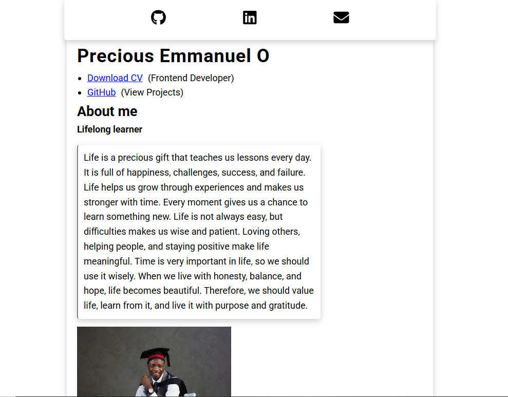
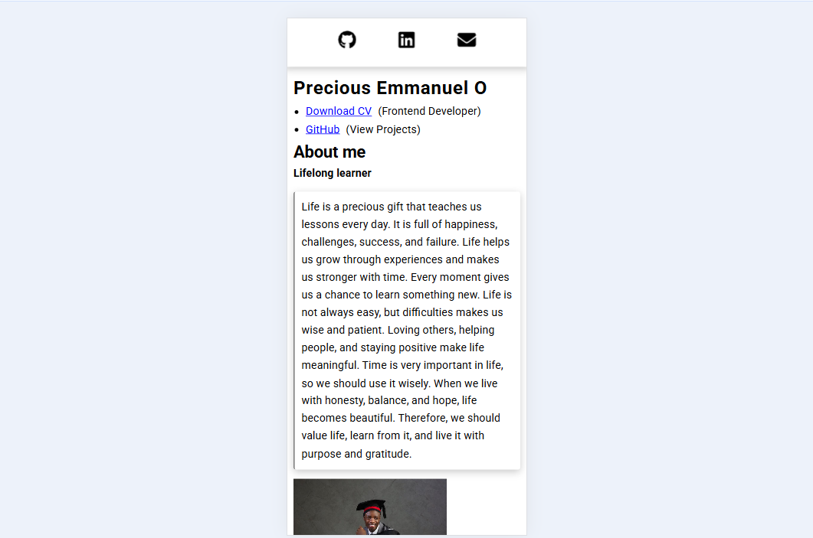

# Precious Emmanuel O

A one-page portfolio for a frontend developer, built with React.

**Live site:** https://oeprxc.github.io/PreciousEmmanuelO/



## About this project

This is my personal portfolio. It is intentionally small: one page, a clear introduction, and quick links to everything a recruiter or collaborator might want.

I chose this approach on purpose. My CV holds my details, my LinkedIn holds my About section, and my GitHub holds my projects. Instead of repeating all of that in a heavy, colorful site. I have built a portfolio at each stage of my learning (HTML and CSS, then JavaScript). This one marks my move into React.

## What's on the page

- **Sticky icon bar** with links to GitHub, LinkedIn and email. It stays at the top while you scroll.
- **Introduction** with my name and role.
- **Download CV** link, opening my CV as a PDF.
- **GitHub link** to view my projects.
- **About me** section with a short personal note and a photo.
- **Responsive layout** that adapts from desktop down to small phones.



## Built with

- **React** for the interface
- **Vite** for the dev server and build
- **react-icons** (Font Awesome 6) for the GitHub, LinkedIn and email icons
- **CSS**, including media queries for mobile
- **gh-pages** for deployment to GitHub Pages
- **Environment variables** for my social links

## Run it locally

You need [Node.js](https://nodejs.org) installed.

```bash
# 1. Clone the repository
git clone https://github.com/oeprxc/PreciousEmmanuelO.git

# 2. Go into the project folder
cd PreciousEmmanuelO

# 3. Install dependencies
npm install

# 4. Create your .env file

# 5. Start the development server
npm run dev
```

Open the local link shown in your terminal.

## Environment variables

My social links are stored in a `.env` file, which is not committed to the repository. This keeps them out of the source code on GitHub.

To run the project, create a `.env` file in the project root (next to `package.json`) using `.env.example` as a guide:

```
VITE_GITHUB_URL=https://github.com/your-username
VITE_LINKEDIN_URL=https://linkedin.com/in/your-profile
VITE_EMAIL=mailto:youremail@example.com
```

A few things to know:

- Variable names must start with `VITE_`, or Vite will not load them.
- Restart the dev server after editing `.env`.
- These links are still visible in the live page, since they are meant to be public. The `.env` only keeps them out of the repository.

## Deployment

The site is deployed to GitHub Pages with the `gh-pages` package.

```bash
npm run deploy
```

This builds the project and publishes it to the `gh-pages` branch. Because the build runs on my computer, my `.env` values are included in the deployed site.

Two settings matter for GitHub Pages:

- `base` in `vite.config.js` is set to the repository name, so files load from the right path.
- The Pages source in the repository settings is the `gh-pages` branch.

---

## What I learned

- Building and structuring a React app from scratch
- Using environment variables with Vite
- Choosing the right icon library after hitting import and naming errors
- Responsive design with media queries
- Deploying with `gh-pages` and fixing base path issues
- Reading console errors to find and fix bugs

## Other projects

- **Lume Jewels:** a demo jewelry storefront designed in Figma and built in React.
- **MyNotes:** a notes app with add, edit, delete and saved notes in the browser.

## Contact

- GitHub: [oeprxc](https://github.com/oeprxc)
- LinkedIn: [Precious O. Emmanuel](https://linkedin.com/in/precious-o-emmanuel-92671142a)
